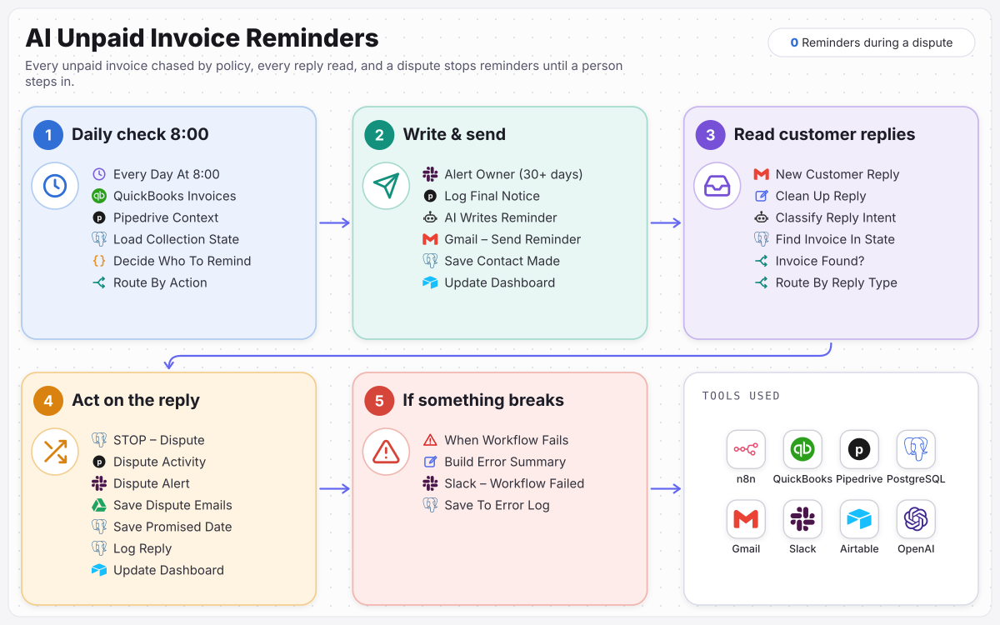

# AI Unpaid Invoice Reminders

Every overdue invoice followed up by policy, and every reply acted on.

> Built for **TalentBridge Staffing**, a fictional sample client. The business, people and data are invented; the workflow is complete and runs.

Every morning, checks QuickBooks, Pipedrive and the collections database for unpaid invoices and sends reminders by set rules. AI writes the emails and reads customer replies; a dispute stops all reminders until a person resolves it.

**Full case study:** [ramonvallejera.com/case-study/ai-unpaid-invoice-reminders](https://ramonvallejera.com/case-study/ai-unpaid-invoice-reminders)

## How it works

1. Daily check
2. Unpaid invoices from QuickBooks
3. Customer context and reminder history
4. Policy rules decide who to remind
5. AI writes the email
6. Sent and recorded
7. Replies read by AI
8. Dispute stops reminders

Built an n8n workflow that runs every morning. It pulls unpaid invoices from QuickBooks, client context from Pipedrive and reminder history from Postgres, and fixed policy rules decide who gets reminded and how firmly. AI writes each email within the approved policy. Customer replies are read by AI and routed: a dispute stops all reminders until a person clears it, and promises, payments, copy requests and wrong contacts each set the next step.

## What's in this repo

| File | What it is |
|---|---|
| `workflow.json` | The n8n workflow, 55 nodes, ready to import |
| `docs/process-map.svg` | The process map from the case study |

Triggers: `Every Day At 8:00`, `New Customer Reply`, `When Workflow Fails`.

## Set it up

1. In n8n, open **Workflows → Import from File** and choose `workflow.json`.
2. Create these credentials and select them on the nodes that need them:

   - PostgreSQL (12 nodes)
   - Slack (OAuth2) (10 nodes)
   - Pipedrive (3 nodes)
   - Gmail (OAuth2) (3 nodes)
   - OpenAI (2 nodes)
   - Airtable (personal access token) (2 nodes)
   - QuickBooks Online (OAuth2) (2 nodes)
   - Google Drive (OAuth2) (1 node)

3. Replace the placeholders with your own records:

   - `YOUR_AIRTABLE_BASE_ID` (2×)
   - `YOUR_AIRTABLE_TABLE_ID` (5×): each node keeps the original table name as a hint
   - `YOUR_DRIVE_FOLDER_ID` (1×)
   - `YOUR_DRIVE_ID` (1×)
   - `YOUR_SLACK_CHANNEL_ID` (10×): the channel that receives alerts and approvals

4. Run it once with test data, then activate it.

Tools: n8n, QuickBooks, Pipedrive, PostgreSQL, Gmail, Slack, Airtable, OpenAI.

## Notes

- Credentials, webhook IDs, pinned test data and account-specific IDs were removed before publishing. n8n assigns new webhook URLs on import.
- Built by [Ramon Vallejera Jr.](https://ramonvallejera.com), AI Automation Engineer. Questions or a build like this for your team: [ramonvallejera.com/contact](https://ramonvallejera.com/contact).
